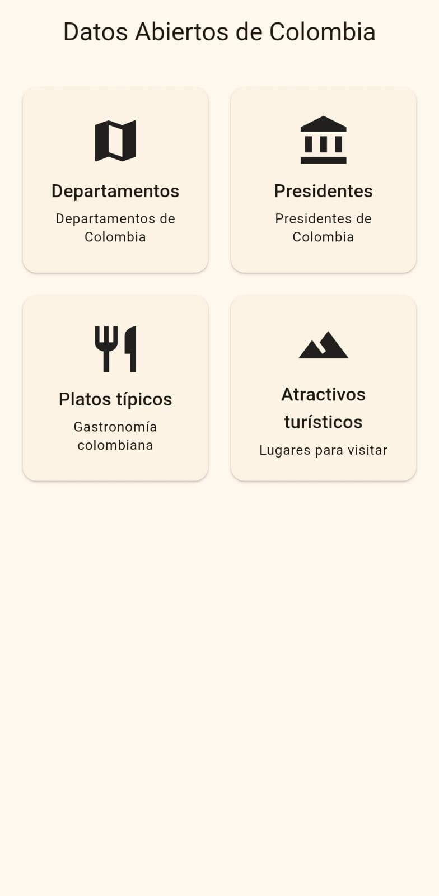
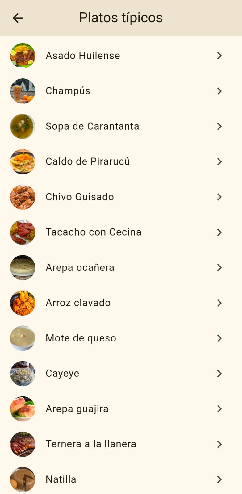
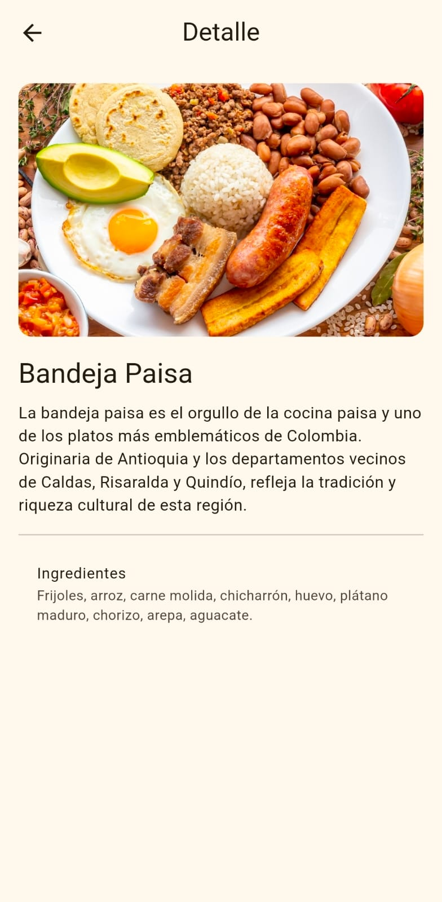
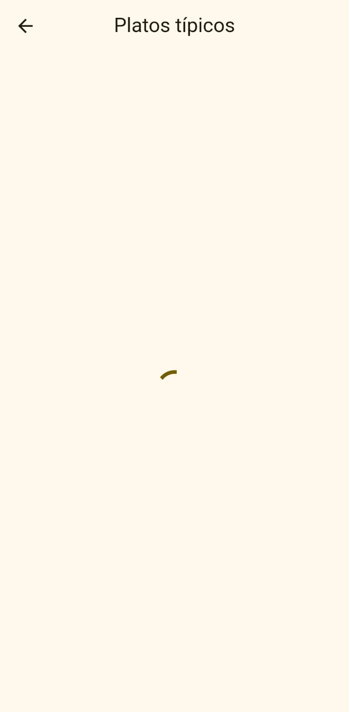

# Datos Abiertos de Colombia (Flutter)

App Flutter que consume la API pública [API Colombia](https://api-colombia.com/)
([Swagger](https://api-colombia.com/swagger/index.html)).

## API y endpoints usados
URL base: `https://api-colombia.com/api/v1`

| Endpoint | Uso |
|---|---|
| `/Department` y `/Department/{id}` | Listado y detalle de departamentos |
| `/President` y `/President/{id}` | Presidentes |
| `/TypicalDish` y `/TypicalDish/{id}` | Platos típicos |
| `/TouristicAttraction` y `/TouristicAttraction/{id}` | Atractivos turísticos |

## Arquitectura
lib/
config/ endpoints.dart (EndpointConfig: ruta, icono y parser por endpoint)
models/ modelos con fromJson/toJson + contrato común ApiItem
routes/ app_router.dart (go_router)
services/ api_colombia_service.dart (HTTP, excepciones y status codes)
themes/ app_theme.dart
views/ dashboard_view, listado_view, detalle_view
widgets/ endpoint_card, loading_view, error_view
main.dart

**Decisión técnica:** todos los modelos implementan `ApiItem` y cada endpoint se
describe con `EndpointConfig`, así una sola vista de listado y una de detalle sirven
para todos los endpoints.

## Rutas go_router
| Nombre | Path | Parámetros |
|---|---|---|
| dashboard | `/` | , |
| list | `/list/:endpoint` | `endpoint` (department, president, dish, attraction) |
| detail | `/list/:endpoint/detail/:id` | `endpoint`, `id` |

## Manejo de estados
- Cargando: `CircularProgressIndicator`
- Éxito: `ListView.builder`
- Error: mensaje + botón Reintentar (sin conexión, timeout, 404, 5xx)

## Ejemplo de respuesta JSON
`GET https://api-colombia.com/api/v1/Department/1`
```json
{"id":1,"name":"Amazonas","description":"Amazonas es uno de los treinta y dos departamentos que, junto con Bogotá, Distrito Capital, forman la República de Colombia. Su capital es Leticia. Está ubicado en el extremo sur del país, en gran parte al sur de la línea ecuatorial, en la región Amazonia. Limita al norte con Caquetá y Vaupés, al este con el estado brasileño del mismo nombre, al sur con el departamento peruano de Loreto y al oeste con Putumayo. Con 110 000 km² es el departamento más extenso de Colombia, con unos 75\u00A0000 habitantes en 2015, el cuarto menos poblado —por delante de Vichada, Vaupés y Guainía, el menos poblado— y con 0.68\u00A0hab/km², el tercero menos densamente poblado, por delante de Vichada y Guainía, el menos densamente poblado.","cityCapitalId":1,"municipalities":2,"surface":109665,"population":82068,"phonePrefix":"8","countryId":1,"cityCapital":{"id":1,"name":"Leticia","description":"Leticia es un municipio fronterizo colombiano, es la capital del departamento del Amazonas. Se encuentra localizado en el extremo sur del país sobre las márgenes del río Amazonas, al sur del área no municipalizada de Tarapacá y al oriente del municipio de Puerto Nariño. Su extensión territorial es de 5968 km², su altura de 82 metros sobre el nivel del mar","surface":5968,"population":42280,"postalCode":"910001","departmentId":1,"department":null,"touristAttractions":null,"presidents":null,"indigenousReservations":null,"airports":null,"radios":null,"urbanCenters":null,"higherEducationInstitutions":null,"televisionChannels":null},"country":null,"cities":null,"regionId":4,"region":null,"naturalAreas":null,"maps":null,"indigenousReservations":null,"airports":null}
```

## Capturas
| Dashboard | Listado | Detalle |
|---|---|---|
|  |  |  |

| Cargando | Error |
|---|---|
|  |  |

## Paquetes
`http`, `go_router`, `flutter_dotenv`

## Ejecutar
```bash
flutter pub get
flutter run
```
