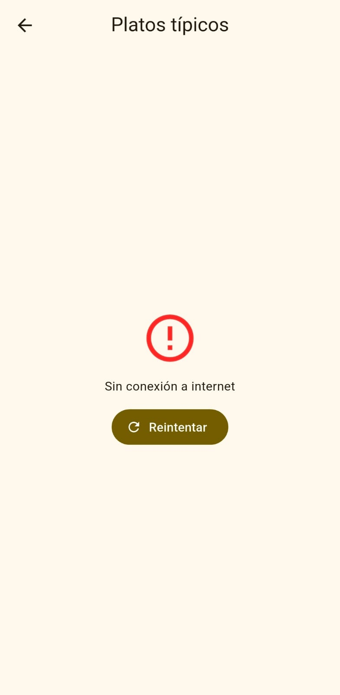

# Datos Abiertos de Colombia (Flutter)

App Flutter que consume la API pública [API Colombia](https://api-colombia.com/)
([Swagger](https://api-colombia.com/swagger/index.html)).

## API y endpoints usados
URL base: `https://api-colombia.com/api/v1`

| Endpoint | Uso |
|---|---|
| `/Department` y `/Department/{id}` | Listado y detalle de departamentos |
| `/President` y `/President/{id}` | Presidentes |
| `/TypicalDish` y `/TypicalDish/{id}` | Platos típicos |
| `/TouristicAttraction` y `/TouristicAttraction/{id}` | Atractivos turísticos |

## Arquitectura
lib/
config/ endpoints.dart (EndpointConfig: ruta, icono y parser por endpoint)
models/ modelos con fromJson/toJson + contrato común ApiItem
routes/ app_router.dart (go_router)
services/ api_colombia_service.dart (HTTP, excepciones y status codes)
themes/ app_theme.dart
views/ dashboard_view, listado_view, detalle_view
widgets/ endpoint_card, loading_view, error_view
main.dart

**Decisión técnica:** todos los modelos implementan `ApiItem` y cada endpoint se
describe con `EndpointConfig`, así una sola vista de listado y una de detalle sirven
para todos los endpoints.

## Rutas go_router
| Nombre | Path | Parámetros |
|---|---|---|
| dashboard | `/` | , |
| list | `/list/:endpoint` | `endpoint` (department, president, dish, attraction) |
| detail | `/list/:endpoint/detail/:id` | `endpoint`, `id` |

## Manejo de estados
- Cargando: `CircularProgressIndicator`
- Éxito: `ListView.builder`
- Error: mensaje + botón Reintentar (sin conexión, timeout, 404, 5xx)

## Ejemplo de respuesta JSON
`GET https://api-colombia.com/api/v1/Department/1`
```json
PEGA_AQUI_EL_JSON_REAL
```

## Capturas
| Dashboard | Listado | Detalle |
|---|---|---|
|  |  |  |

| Cargando | Error |
|---|---|
|  |  |

## Paquetes
`http`, `go_router`, `flutter_dotenv`

## Ejecutar
```bash
flutter pub get
flutter run
```
